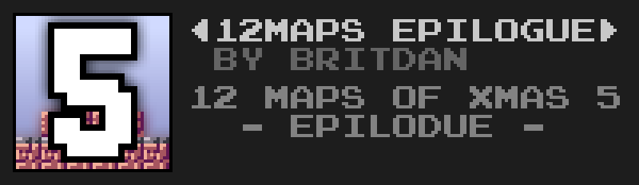
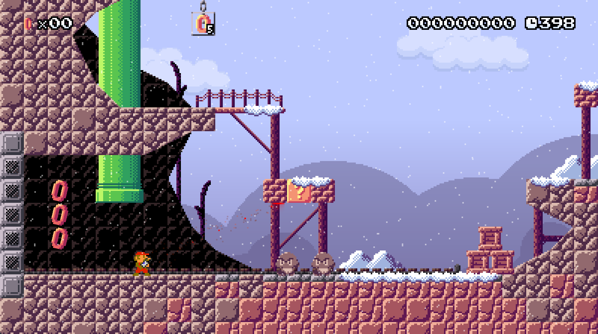
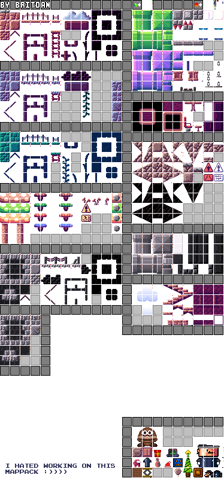

# 12 Maps Of Christmas 5 (Epilogue)

=== "Mappack Card"

    <figure markdown="span">
      
      <figcaption>The mappacks icon, name and description.</figcaption>
    </figure>

=== "First Level"

    <figure markdown="span">
      
      <figcaption>A screenshot of the first level from the mappack.</figcaption>
    </figure>

=== "Tileset"

    <figure markdown="span">
      
      <figcaption>The tileset used in the mappack.</figcaption>
    </figure>

12 Maps Of Christmas 5 is a winter themed platformer based on SMB and Would you believe it, another obvious sequel to [12 Maps Of Christmas 4](https://greatbritdan.github.io/archives/mappacks/12moc4/) released for Alesan99's Entities, Originally released on the 31st of December, 2024. It features 12 levels and is the final entry in the pentalogy, hence the subtile.

## Credits
Enemies, testing and other general help by [WilliamFrog](https://forum.stabyourself.net/memberlist.php?mode=viewprofile&u=4261).

## Links

Both the original mappack as well as a fixed port are avaialble to download here. The port only fixes issues caused since release due to AE updates, No content has been changed. I recommend using the fixed port as the original version is here mainly for archival purposes.

[Fixed Download :material-download:](https://github.com/greatbritdan/archives/raw/refs/heads/main/docs/assets/downloads/12moc5_arc.zip){ .md-button }
[Original Download :material-download:](https://github.com/greatbritdan/archives/raw/refs/heads/main/docs/assets/downloads/12moc5.zip){ .md-button }

[Original Post :material-link:](https://forum.stabyourself.net/viewtopic.php?t=5679){ .md-button }