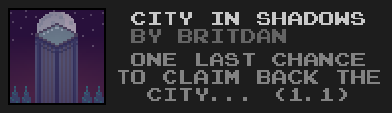
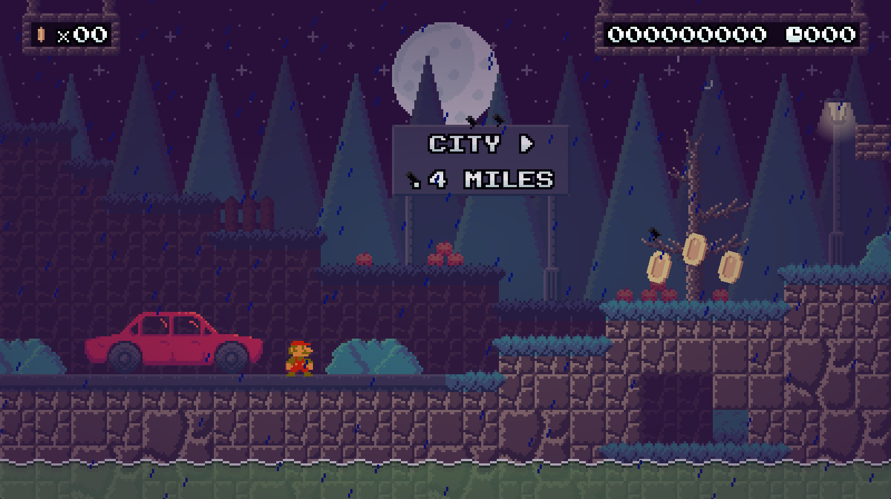
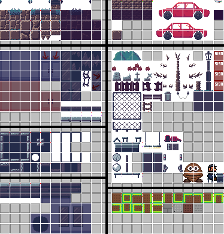

# City In Shadows

=== "Mappack Card"

    <figure markdown="span">
      
      <figcaption>The mappacks icon, name and description.</figcaption>
    </figure>

=== "First Level"

    <figure markdown="span">
      
      <figcaption>A screenshot of the first level from the mappack.</figcaption>
    </figure>

=== "Tileset"

    <figure markdown="span">
      
      <figcaption>The tileset used in the mappack.</figcaption>
    </figure>

City In Shadows is a halloween themed platformer released for Alesan99's Entities, Originally released on the 24th of December, 2021. It features 4 levels and also includes 2 versions of a tower boss.

## Videos

  <iframe width="1280" height="720" src="https://www.youtube.com/embed/nyuNIktGAr0" frameborder="0" allowfullscreen></iframe>

## Credits
!!! warning "AI Slop"

    This artist now makes AI music, This music was picked before this happened and I do not support them or their work!

[Forest Theme](https://youtu.be/VUh7WCDolG8?si=pBsnGoSsuHA7hSCr) made by [Pix](https://www.youtube.com/@Pixverses).

[City Theme](https://youtu.be/VUHcyGeFP-A?si=jh9jM9J3b09IDnVc) made by [Pix](https://www.youtube.com/@Pixverses).

[Tower Theme](https://youtu.be/2Mg6b0LJfM8?si=KPBNeR69tVK3zkIh) made by [Pix](https://www.youtube.com/@Pixverses).

## Links

Both the original mappack as well as a fixed port are avaialble to download here. The port only fixes issues caused since release due to AE updates, No content has been changed. I recommend using the fixed port as the original version is here mainly for archival purposes.

[Fixed Download :material-download:](https://github.com/greatbritdan/archives/raw/refs/heads/main/docs/assets/downloads/cityinshadows_arc.zip){ .md-button }
[Original Download :material-download:](https://github.com/greatbritdan/archives/raw/refs/heads/main/docs/assets/downloads/cityinshadows.zip){ .md-button }

[Original Post :material-link:](https://forum.stabyourself.net/viewtopic.php?t=5608){ .md-button }